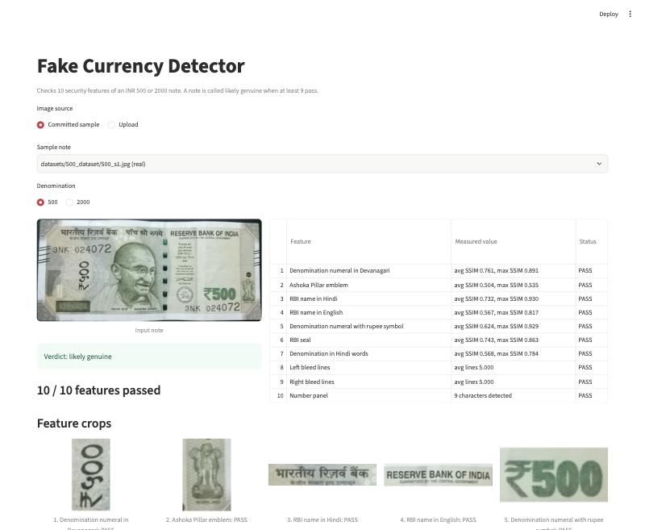

# Fake Currency Detector

Checks ten printed security features on a photo of an Indian ₹500 or ₹2000 note using classical image processing — ORB feature matching, structural similarity (SSIM), thresholding and contour analysis — and reports which features pass.

<p align="center">
  
</p>

It is a study of how far template matching can go on a small set of images, not a tool for deciding whether real money is genuine. See [Limitations](#limitations).

## Quick start

Python 3.12 (3.10 and 3.11 should also work).

```bash
git clone https://github.com/yxshee/fake-currency-detector.git
cd fake-currency-detector
python3 -m venv .venv && source .venv/bin/activate   # Windows: .venv\Scripts\activate
pip install -r requirements.txt
```

Check one of the sample notes from the command line:

```bash
python -m fcd detect datasets/500_dataset/500_s1.jpg --denomination 500
```

```text
 1. Denomination numeral in Devanagari       PASS  avg SSIM 0.761, max SSIM 0.891
 2. Ashoka Pillar emblem                     PASS  avg SSIM 0.504, max SSIM 0.535
 ...
10. Number panel                             PASS  9 characters detected
10 / 10 features passed
Verdict: likely genuine
```

Or use the app, which lets you pick any sample note or upload your own image:

```bash
streamlit run app.py
```

## What it checks

A note image is resized to a fixed size, blurred and converted to grayscale. Ten features are then tested with three methods.

| # | Feature | Method | Passes when |
|---|---|---|---|
| 1 | Denomination numeral in Devanagari | Template matching | Average SSIM over six templates reaches the feature's minimum (0.40 to 0.50), or the best SSIM reaches 0.79 |
| 2 | Ashoka Pillar emblem | Template matching | as above |
| 3 | RBI name in Hindi | Template matching | as above |
| 4 | RBI name in English | Template matching | as above |
| 5 | Denomination numeral with rupee symbol | Template matching | as above |
| 6 | RBI seal | Template matching | as above |
| 7 | Denomination in Hindi words | Template matching | as above |
| 8 | Left bleed lines | Line counting | Average line count is 4.7 to 5.6 (₹500) or 6.7 to 7.6 (₹2000) |
| 9 | Right bleed lines | Line counting | as above |
| 10 | Serial number panel | Contour counting | Exactly nine character boxes are found at some threshold |

**Template matching (features 1 to 7).** Each feature has six reference crops in `datasets/Features/`. For each one, ORB keypoints are matched between the reference and a fixed search area of the note, a RANSAC homography locates the reference inside the note, and the located region is compared with the reference using SSIM.

**Line counting (features 8 and 9).** A fixed strip at each edge is thresholded, and the white-to-black transitions down each pixel column are counted and averaged. A ₹500 note has five bleed lines per side and a ₹2000 note has seven.

**Contour counting (feature 10).** The serial number area is thresholded at a series of levels. Contours are filtered by size and position; the feature passes if nine character-sized boxes remain at any level.

A note is reported as "likely genuine" when at least 9 of the 10 features pass, the rule used in the project's original report.

## Results

`python -m fcd evaluate` runs every note image in this repository: 19 genuine and 12 counterfeit. The full per-note table is in [results/evaluation.md](results/evaluation.md).

| Notes | Genuine classified genuine | Counterfeit classified counterfeit | All correct |
|---|---|---|---|
| ₹500 | 9 / 10 | 6 / 6 | 15 / 16 |
| ₹2000 | 7 / 9 | 5 / 6 | 12 / 15 |
| All | 16 / 19 (84%) | 11 / 12 (92%) | 27 / 31 (87%) |

Each note is analysed in well under a second on a laptop.

Read these numbers with two cautions. First, there are only 31 images. Second, this is not a held-out test: the thresholds are hand-set constants and no images were kept aside, so the figures describe how well the method fits this set, not how it would do on new photos. The original report gives 15 of 19 and 10 of 12 for the notebook implementation, which had a scoring bug in the ₹500 path that the package does not reproduce.

## Limitations

- **It needs a clean, flat, front-on image cropped to the note.** Every search area is a fixed pixel box after resizing. A tilted, folded or loosely cropped photo fails for reasons that have nothing to do with authenticity.
- **It only looks at printed features visible in an ordinary photo.** It does not examine the watermark, the security thread, colour-shifting ink, microprinting, raised print or anything under ultraviolet light, which is where real authentication happens. Because it only compares printed patterns, a faithful colour print of a genuine note would be expected to pass.
- **One of the twelve counterfeit samples passes all ten checks.** See `2000_f6` in the results table.
- **Two denominations only**, and the ₹2000 note was withdrawn from circulation by the Reserve Bank of India in 2023. It is kept because the original project covered it.
- **Do not use this to accept or reject real currency.**

## Project layout

| Path | Contents |
|---|---|
| `fcd/config.py` | Every constant, per denomination: sizes, search areas, thresholds |
| `fcd/detector.py` | The three methods and `analyze(image, denomination)` |
| `fcd/cli.py` | `python -m fcd detect` and `python -m fcd evaluate` |
| `app.py` | Streamlit demo |
| `tests/` | Tests for the configuration, the helper functions, determinism and the app |
| `datasets/` | 19 genuine and 12 counterfeit note images, and the reference crops |
| `results/` | Output of `python -m fcd evaluate` |
| `code/` | The original Jupyter notebooks with a Tkinter interface, kept for reference. They expect Windows-style paths and are superseded by `fcd/`. |
| `assets/Report.pdf` | The original project report |

## Tests

```bash
pip install -r requirements-dev.txt
pytest -q
```

The same tests run on every push in [GitHub Actions](.github/workflows/tests.yml).

## Background

The approach follows the project report in [assets/Report.pdf](assets/Report.pdf), which took its starting idea from "Fake Indian Currency Note Recognition" (Mangayarkarasi et al., IRJET, 2020).

## License

MIT. See [LICENSE](LICENSE).
